# TradePulse: Comprehensive Machine Learning Pipeline Documentation

**Author:** TradePulse Engineering & Quantitative Research Team  
**Institution:** Indian Institute of Technology Patna (IIT Patna), IMPACT Lab  
**Subject:** End-to-End Machine Learning System Walkthrough & Architectural Defense  
**Scope:** Machine Learning, Statistical Inference, Gating, and Validation Pipeline Only  
**Target Asset:** META Platforms Inc. (NASDAQ: `META`)  
**Data Cadence:** 5-Minute Closed Candlestick Bars (Alpaca IEX Market Feed)  
**Prediction Horizon:** 15 Minutes Forward ($3$ Bars Ahead, Intraday Only)  
**Target Formulation:** 3-Class Return Direction (`Down = -1`, `Neutral = 0`, `Up = +1`) with $\theta = \pm 15\text{ bps}$  
**Reference Document Date:** November 2026  

---

## 0. Overview

### Problem Statement
The TradePulse machine learning pipeline addresses the problem of short-term intraday directional forecasting on liquid equity markets. Specifically, given a sequence of 5-minute closed candlestick bars for `META` on the NASDAQ exchange, the model predicts the directional sign of the forward 15-minute return ($R_{t, t+3} = \frac{Close_{t+3}}{Close_t} - 1$) classified into three mutually exclusive regimes: **Down ($-1$)**, **Neutral ($0$)**, or **Up ($+1$)** relative to a symmetric hurdle $\theta = \pm 15\text{ basis points}$ ($\pm 0.15\%$). The final deliverable of the machine learning pipeline is a frozen, causally leak-free, calibrated probability ensemble model with dynamic conviction gating, packaged with cryptographic SHA-256 manifests, reproducible training pipelines, and sub-millisecond live inference serving.

```mermaid
flowchart TD
    subgraph S1["1. Data Acquisition & Hygiene"]
        A1["Raw Alpaca IEX 5-Min Bars (20,516 bars)<br/><code>data_collection.py</code>"] --> A2["Exchange Calendar Alignment (NASDAQ)<br/><code>pandas-market-calendars</code>"]
        A2 --> A3["Sanity Checks & Gap Detection<br/>0 Missing Regular Bars (0.00% fill)<br/><code>preprocessing.py</code>, <code>validation.py</code>"]
        A3 --> A4["Cleaned Regular Session Dataset (19,818 bars)<br/><code>META_5min_clean.csv</code>"]
    end

    subgraph S2["2. Labeling & Chronological Splitting"]
        B1["3-Bar Intraday Forward Return R(t, t+3)<br/>Drop Final 3 Bars of Every Session (765 bars dropped)<br/><code>targets.py</code>"]
        A4 --> B1
        B1 --> B2["Leak-Free Chronological Split (Split Config)<br/>Train: 164 days | Embargo 1: 1 day | Val: 42 days | Embargo 2: 1 day | Test: 47 days<br/><code>split.py</code>"]
        B2 --> B3["Sealed Held-Out Test Set (3,525 bars)<br/>Strictly Touched Once<br/><code>test.csv</code>"]
        B2 --> B4["Training Set (12,193 valid bars)<br/>Validation Set (3,150 valid bars)"]
    end

    subgraph S3["3. Causal Feature Engineering"]
        C1["29 Causal Stationarized Features<br/>Max Lookback = 35 bars (Warmup)<br/><code>features.py</code>"]
        B4 --> C1
        C1 --> C2["Fit RobustScaler on Train Rows Only<br/><code>feature_scaler.joblib</code>"]
    end

    subgraph S4["4. Baseline & Candidate Modeling"]
        D1["Baselines: Majority, Always-Up, Momentum, RSI, Time-of-Day<br/><code>04_baselines.ipynb</code>"]
        C2 --> D1
        C2 --> D2["5-Fold Purged Walk-Forward CV (3-bar purge)<br/>Evaluate Models: LR, RF, XGBoost<br/><code>evaluate.py</code>, <code>train.py</code>"]
    end

    subgraph S5["5. Iterative Label Selection & Calibration"]
        E1["Round 1: label_fixed_20bp Selected<br/>Suffers from Signal Starvation (62% Neutral)<br/><code>chosen_label.json</code>"]
        D2 --> E1
        E1 -->|Backtrack & Expand| E2["Round 2: 7-Label Cross-Evaluation<br/>Select label_fixed_15bp by Deployability<br/><code>label_expansion_report.md</code>"]
        E2 --> E3["50/50 Ensemble (RF + LR) Selected<br/>Statistical Tie with Lowest Variance<br/><code>model_comparison_label_fixed_15bp_report.md</code>"]
        E3 --> E4["Platt Sigmoid (OVR) Calibration on OOF Probabilities<br/><code>calibration.py</code>"]
        E4 --> E5["Conviction Gating: max(P_down, P_up) >= tau<br/><code>gating.py</code>"]
    end

    subgraph S6["6. Recency Weighting & Final Test Unsealing"]
        F1["Recency Weighting Evaluation (Half-lives: 180d, 90d, 45d vs Uniform)<br/>Bootstrap CI Spans 0 -> Uniform Retained<br/><code>phase1_recency_weighting_results.json</code>"]
        E5 --> F1
        F1 --> F2["One-Time Held-Out Test Evaluation (Test Touched Once)<br/>Acc: 46.81%, BalAcc: 42.56%, SignAcc: 54.11%<br/>Gross: +1.29 bps, Net @ 8bp: -6.71 bps<br/><code>step12_final_test_results.json</code>"]
    end

    subgraph S7["7. Full Dataset Refit & Production Packaging"]
        G1["Final Refit on All 253 Sessions (18,868 rows)<br/>tau_final = 0.2635 (~37.5 sigs/day)<br/><code>train_final.py</code>"]
        F2 --> G1
        G1 --> G2["Production Artifacts & SHA-256 Hashes<br/><code>model_final.joblib</code>, <code>scaler_final.joblib</code>, <code>calibrator_final.joblib</code><br/><code>training_manifest_final.json</code>"]
        G2 --> G3["Parity & Resilience Verification (7/7 Passed)<br/>Dry-Run Full Session Replay (78 bars, 0 crashes)<br/><code>test_parity_final.py</code>, <code>dry_run_final.py</code>"]
    end
```

### Table of Pipeline Steps

| Step # | Stage Name | Primary Purpose | Primary Code / Notebook / Metadata Files | Status |
| :---: | :--- | :--- | :--- | :---: |
| **1** | Problem Definition | Establish prediction horizon, asset, classes, and economic cost hurdle | [`artifacts/metadata/final_config_final.json`](file:///e:/Projects/Trading%20Project/TradePulse/artifacts/metadata/final_config_final.json) | **Done** |
| **2** | Data Collection | Fetch 1 year of raw 5-minute IEX bars via Alpaca API in rate-limited chunks | [`ml/data_collection.py`](file:///e:/Projects/Trading%20Project/TradePulse/ml/data_collection.py), [`data/raw/META_5min.csv`](file:///e:/Projects/Trading%20Project/TradePulse/data/raw/META_5min.csv) | **Done** |
| **3** | Data Audit & Cleaning | Filter regular trading hours (RTH), verify calendar alignment, test fill rate | [`ml/preprocessing.py`](file:///e:/Projects/Trading%20Project/TradePulse/ml/preprocessing.py), [`ml/validation.py`](file:///e:/Projects/Trading%20Project/TradePulse/ml/validation.py) | **Done** |
| **4** | Target Definition | Define intraday forward returns, candidate $\theta$ cuts, and boundary isolation | [`ml/targets.py`](file:///e:/Projects/Trading%20Project/TradePulse/ml/targets.py), [`artifacts/metadata/target_thresholds.json`](file:///e:/Projects/Trading%20Project/TradePulse/artifacts/metadata/target_thresholds.json) | **Done** |
| **5** | Chronological Split | Split into Train, Val, Test with 1-day embargo barriers; seal Test Set | [`ml/split.py`](file:///e:/Projects/Trading%20Project/TradePulse/ml/split.py), [`artifacts/metadata/split_config.json`](file:///e:/Projects/Trading%20Project/TradePulse/artifacts/metadata/split_config.json) | **Done** |
| **6** | Exploratory Data Analysis | Quantify volume U-curve, return moments, autocorrelation on Train only | [`notebooks/03_eda_training_data.ipynb`](file:///e:/Projects/Trading%20Project/TradePulse/notebooks/03_eda_training_data.ipynb) | **Done** |
| **7** | Feature Engineering | Construct 29 causal indicators; fit `RobustScaler` on Train partition | [`ml/features.py`](file:///e:/Projects/Trading%20Project/TradePulse/ml/features.py), [`artifacts/models/feature_scaler.joblib`](file:///e:/Projects/Trading%20Project/TradePulse/artifacts/models/feature_scaler.joblib) | **Done** |
| **8** | Baseline Models | Benchmark naive rules (Majority, Always-Up, Momentum, RSI, Time-of-Day) | [`notebooks/04_baselines.ipynb`](file:///e:/Projects/Trading%20Project/TradePulse/notebooks/04_baselines.ipynb), [`artifacts/metadata/baseline_benchmark_results.json`](file:///e:/Projects/Trading%20Project/TradePulse/artifacts/metadata/baseline_benchmark_results.json) | **Done** |
| **9** | Models & Tuning | Train LR, RF, XGBoost under 5-fold Purged Walk-Forward Cross-Validation | [`ml/train.py`](file:///e:/Projects/Trading%20Project/TradePulse/ml/train.py), [`artifacts/metadata/random_forest_tuning_summary.json`](file:///e:/Projects/Trading%20Project/TradePulse/artifacts/metadata/random_forest_tuning_summary.json) | **Done** |
| **10** | Label & Model Selection | Round 1 selects `20bp`; Round 2 expands to 7 labels; selects `15bp` + Ensemble | [`ml/label_expansion_experiments.py`](file:///e:/Projects/Trading%20Project/TradePulse/ml/label_expansion_experiments.py), [`reports/label_expansion_report.md`](file:///e:/Projects/Trading%20Project/TradePulse/reports/label_expansion_report.md) | **Done** |
| **11** | Diagnostics & Error Analysis | Analyze performance by time-of-day, volatility tertiles, and group ablation | [`ml/diagnostics.py`](file:///e:/Projects/Trading%20Project/TradePulse/ml/diagnostics.py), [`reports/step13_error_analysis_and_robustness_report.md`](file:///e:/Projects/Trading%20Project/TradePulse/reports/step13_error_analysis_and_robustness_report.md) | **Done** |
| **12** | Probability Calibration | Fit Platt Sigmoid (One-vs-Rest) on out-of-fold cross-validation probabilities | [`ml/calibration.py`](file:///e:/Projects/Trading%20Project/TradePulse/ml/calibration.py), [`artifacts/models/calibrator_final.joblib`](file:///e:/Projects/Trading%20Project/TradePulse/artifacts/models/calibrator_final.joblib) | **Done** |
| **13** | Signal Gating Rule | Derive conviction threshold $\tau$ from OOF percentiles to target active frequency | [`ml/gating.py`](file:///e:/Projects/Trading%20Project/TradePulse/ml/gating.py), [`artifacts/metadata/signal_rule_final.json`](file:///e:/Projects/Trading%20Project/TradePulse/artifacts/metadata/signal_rule_final.json) | **Done** |
| **14** | Cost-Aware Simulation | Simulate non-overlapping 15m holding periods with 8 bps institutional drag | [`ml/gating.py`](file:///e:/Projects/Trading%20Project/TradePulse/ml/gating.py), [`reports/step12_final_test_evaluation_report.md`](file:///e:/Projects/Trading%20Project/TradePulse/reports/step12_final_test_evaluation_report.md) | **Done** |
| **15** | Recency & Final Evaluation | Test half-life decay; single test unsealing; refit on all 253 sessions | [`ml/train_final.py`](file:///e:/Projects/Trading%20Project/TradePulse/ml/train_final.py), [`reports/report_final.md`](file:///e:/Projects/Trading%20Project/TradePulse/reports/report_final.md) | **Done** |
| **16** | Packaging & Reproducibility | Create `TradePulsePredictorFinal`, SHA-256 manifest, parity verification | [`ml/predict_final.py`](file:///e:/Projects/Trading%20Project/TradePulse/ml/predict_final.py), [`tests/test_parity_final.py`](file:///e:/Projects/Trading%20Project/TradePulse/tests/test_parity_final.py) | **Done** |

---

## 1. Problem Definition and Design Choices

### What Was Done
- **Asset Selection:** Meta Platforms Inc. (`META`) listed on NASDAQ.
- **Bar Cadence:** 5-minute closed candlestick bars ($78$ bars per standard regular trading session: 09:30 to 16:00 Eastern Time).
- **Prediction Horizon:** 15 minutes forward ($3$ consecutive 5-minute bars, $t \to t+3$).
- **Target Classes:** 3 discrete regimes based on forward return $R_{t, t+3} = \frac{Close_{t+3}}{Close_t} - 1$:
  - $\text{Up } (+1)$: $R_{t, t+3} \ge +\theta$
  - $\text{Down } (-1)$: $R_{t, t+3} \le -\theta$
  - $\text{Neutral } (0)$: $-\theta < R_{t, t+3} < +\theta$
- **Selected Threshold:** $\theta = \pm 15\text{ bps}$ ($\pm 0.15\%$).
- **Success Metrics:** Balanced Accuracy, Macro-F1, Binary Sign Accuracy on directional bars, Up-Down ROC-AUC, and Cost-Adjusted Net Return in basis points.
- **Cost Assumption:** $8.0\text{ bps}$ ($0.08\%$) round-trip institutional friction ($5\text{ bps}$ bid-ask spread $+ 3\text{ bps}$ broker commissions/slippage).

### Why (Reasoning & Alternatives Considered)
- **Why 5-Minute Bars?**
  - *Alternatives Considered:* 1-minute bars, 15-minute bars, hourly bars.
  - *Reasoning:* 1-minute bars in algorithmic trading are heavily dominated by high-frequency market-microstructure noise (bid-ask bounce, order queue flickers), requiring colocation. 15-minute and hourly bars produce too few samples per day ($26$ and $6.5$ bars respectively) to train statistical ML models without multi-year regime shifts. 5-minute bars strike the optimal trade-off between statistical sample density ($19,818$ regular session bars per year) and economic tradability.
- **Why 15 Minutes Forward ($3$ Bars)?**
  - *Alternatives Considered:* 1 bar ($5$m), 6 bars ($30$m), 12 bars ($60$m).
  - *Reasoning:* A 1-bar ($5$m) forward horizon rarely generates price movement sufficient to clear an 8 bps transaction cost hurdle (median 5m move in META is only $\sim 7$ bps). A 15-minute horizon ($3$ bars) allows sufficient price discovery travel for large institutional orders to manifest directional momentum without introducing overnight gap risk.
- **Why Three Classes (Up / Neutral / Down) Rather Than Binary or Continuous Regression?**
  - *Alternatives Considered:* Continuous return regression, 2-class binary classification ($\text{Up vs Down}$).
  - *Reasoning:* In financial markets, the vast majority of intraday periods exhibit zero actionable drift (consolidation, mean-reversion chop). Binary classification forces a trader to take an active long or short position on every single candle, even when the market is dead flat. Continuous regression minimizes Mean Squared Error (MSE), which is dominated by large outlier spikes rather than directional predictability. A 3-class framework explicitly acknowledges the **Neutral** regime, permitting the model to abstain when conviction is low.
- **Why Alpaca IEX Feed?**
  - *Alternatives Considered:* Full Consolidated Tape (CTA/UTP / SIP), Polygon.io, Yahoo Finance.
  - *Reasoning:* Alpaca provides a free, programmatic, institutional-grade REST and WebSocket API with zero historical survivorship bias. While IEX accounts for a partial fraction of total US equity volume ($\sim 2-4\%$), its price prints represent real executed trades matching the national best bid/offer (NBBO). Volume features were normalized to prevent partial-volume bias.
- **Decision Authority:** Initiated by project guidelines; approved and ratified in configuration freezes by the developer.

### Outputs
- Specification recorded in [`artifacts/metadata/final_config_final.json`](file:///e:/Projects/Trading%20Project/TradePulse/artifacts/metadata/final_config_final.json) and [`artifacts/metadata/ui_summary_final.json`](file:///e:/Projects/Trading%20Project/TradePulse/artifacts/metadata/ui_summary_final.json).

### Limitations
- The model is restricted to a single stock (`META`). Findings cannot be assumed to generalize to low-volatility ETFs or illiquid small-cap equities without recalibration.

---

## 2. Data Collection

### What Was Done
- **Data Source:** Alpaca Data API v2 (`StockHistoricalDataClient`).
- **Data Feed:** `DataFeed.IEX` (Investors Exchange).
- **Price Adjustment:** `Adjustment.RAW` (unadjusted prices; splits and cash dividends audited).
- **Date Range:** November 3, 2025 at 13:20:00 UTC through November 6, 2026 at 20:55:00 UTC (1 full calendar year).
- **Total Downloaded Rows:** **20,516 rows** saved to [`data/raw/META_5min.csv`](file:///e:/Projects/Trading%20Project/TradePulse/data/raw/META_5min.csv).
- **Raw File Size:** 1,723,221 bytes ($1.64$ MB).
- **Cryptographic Hash (SHA-256):** `431c6dddfeeda497bebb395986699a9fe56d69f548e8281e9d0bc7f27b6c5256`.
- **Columns (9 total):**
  1. `symbol` (str): Ticker symbol (`META`).
  2. `timestamp` (str / ISO-8601): Bar start time in UTC.
  3. `open` (float): Opening price of the 5-minute interval.
  4. `high` (float): Highest traded price in the interval.
  5. `low` (float): Lowest traded price in the interval.
  6. `close` (float): Closing traded price of the interval.
  7. `volume` (float): Total shares transacted on IEX in the interval.
  8. `trade_count` (float): Number of discrete executed transactions.
  9. `vwap` (float): Volume-Weighted Average Price on IEX during the 5-minute bar.
- **Collection Method:** Partitioned dynamically into monthly calendar chunks (`generate_monthly_chunks()`) with a rate-limit sleep of $0.5$ seconds and exponential backoff retry logic (`MAX_RETRIES = 3`).

### Why (Reasoning & Alternatives Considered)
- **Why Monthly Chunking?** Alpaca enforces rate limits (200 requests/minute on the free tier) and caps individual bar request payloads. Requesting an entire year in a single call causes connection timeouts or silent truncation.
- **Why RAW Price Adjustment?** Backtesting intraday execution requires actual historical quotes. Adjusted prices back-adjust past price levels, corrupting dollar-denominated volatility bounds and bid-ask spread representations.

### Outputs
- Raw CSV: [`data/raw/META_5min.csv`](file:///e:/Projects/Trading%20Project/TradePulse/data/raw/META_5min.csv)
- Metadata Artifact: [`artifacts/metadata/data_collection_metadata.json`](file:///e:/Projects/Trading%20Project/TradePulse/artifacts/metadata/data_collection_metadata.json)

### Results & Findings
- Summary stats on raw data:
  - `open_min`: \$521.07 | `open_max`: \$779.34
  - `close_min`: \$521.08 | `close_max`: \$779.42
  - `volume_sum`: 144,881,610 shares transacted on IEX across 3,743,234 trades.

### Limitations
- The raw dataset included pre-market (04:00–09:30 ET) and after-hours (16:00–20:00 ET) bars (698 total non-RTH bars) which exhibit extreme bid-ask spreads and unrepresentative liquidity. These had to be audited and removed in Step 3.

---

## 3. Data Audit and Cleaning

### What Was Done
The cleaning module ([`ml/preprocessing.py`](file:///e:/Projects/Trading%20Project/TradePulse/ml/preprocessing.py)) and validation module ([`ml/validation.py`](file:///e:/Projects/Trading%20Project/TradePulse/ml/validation.py)) subjected the raw dataset to nine automated structural invariant checks:
1. **Schema Check:** All 9 required OHLCV columns present (0 missing).
2. **Missing Values:** Zero nulls or NaNs across all columns (0 violations).
3. **Monotonicity:** Verified strictly monotonically increasing timestamps (`ts.is_monotonic_increasing = True`).
4. **Duplicate Records:** Duplicate `(symbol, timestamp)` check yielded **0 duplicates**.
5. **Price Non-Negativity:** All price fields verified positive ($> \$0.00$).
6. **Geometric OHLC Invariants:**
   - $High \ge Low$ (0 violations across 20,516 bars)
   - $High \ge \max(Open, Close)$ (0 violations)
   - $Low \le \min(Open, Close)$ (0 violations)
7. **VWAP Bounds:** Verified $Low - 10^{-4} \le VWAP \le High + 10^{-4}$ (0 violations).
8. **Calendar Grid Filtering:** Aligned strictly against the official `pandas-market-calendars` NASDAQ exchange schedule:
   - Filtered out all pre-market and post-market bars.
   - Identified **255 official trading sessions** between 2025-11-03 and 2026-11-06.
   - Verified session types: **253 standard sessions** ($78$ bars each) and **2 official half-days** ($42$ bars each: 2025-11-28 Black Friday, 2026-07-03 pre-Independence Day).
   - Expected scheduled regular bars: $(253 \times 78) + (2 \times 42) = 19,734 + 84 = \mathbf{19,818\text{ bars}}$.
9. **Missing-Bar Policy & Reindexing:**
   - Constructed the canonical regular-hours 5-minute grid.
   - Merged observed bars against the scheduled grid.
   - Counted missing bars requiring forward-fill: **0 bars** (100% of all 19,818 scheduled intervals had trades executed on IEX, yielding an empirical fill rate of **0.00%**).
   - Formulated the synthetic fill function `synthesize_missing_bar()`: sets $O=H=L=C=\text{LastKnownClose}$, $Volume=0$, $Trades=0$, $VWAP=\text{LastKnownVWAP}$, and explicitly tags `is_filled=1`.

### Why (Reasoning & Alternatives Considered)
- **Why Not Drop Missing Intervals Silently?**
  - *Alternatives Considered:* Leaving gaps in time series, simple `df.dropna()`.
  - *Reasoning:* Rolling indicators like EMA, RSI, and MACD rely on a uniform time step $\Delta t = 5\text{ minutes}$. Dropping bars creates variable $\Delta t$, corrupting derivative calculations. However, silent forward-filling creates artificial volume. Explicit tagging (`is_filled=1`) allows models to learn whether data is synthetic.
- **Why Same-Day Isolation for Fills?**
  - *Reasoning:* Forward-filling across overnight sessions would carry the 16:00 close into the 09:30 open, erasing overnight price gaps and causing massive lookahead/stale bias.

### Outputs
- Cleaned CSV: [`data/processed/META_5min_clean.csv`](file:///e:/Projects/Trading%20Project/TradePulse/data/processed/META_5min_clean.csv) ($19,818$ rows)
- Cleaned Parquet: [`data/processed/META_5min_clean.parquet`](file:///e:/Projects/Trading%20Project/TradePulse/data/processed/META_5min_clean.parquet)
- Audit Report: [`reports/step2_data_audit_report.md`](file:///e:/Projects/Trading%20Project/TradePulse/reports/step2_data_audit_report.md)
- Data Dictionary: [`reports/data_dictionary.md`](file:///e:/Projects/Trading%20Project/TradePulse/reports/data_dictionary.md)

### Row Count Reconciliation Table

| Cleaning Stage | Rows In | Rows Out | Delta | Rationale |
| :--- | :---: | :---: | :---: | :--- |
| Raw API Download | — | 20,516 | +20,516 | Full feed including extended hours |
| RTH Filtering (09:30–16:00 ET) | 20,516 | 19,818 | -698 | Dropped illiquid pre/post-market prints |
| Exchange Grid Reindexing | 19,818 | 19,818 | 0 | 0 missing bars; 100% complete grid |

---

## 4. Target (Label) Definition

### What Was Done
Implemented in [`ml/targets.py`](file:///e:/Projects/Trading%20Project/TradePulse/ml/targets.py):
1. **Intraday Return Formula:**
   $$R_{t, t+3} = \frac{Close_{t+3}}{Close_t} - 1$$
2. **Same-Day Boundary Isolation:**
   - Grouped strictly by `session_date`.
   - The final 3 bars of every session ($t = 15:45, 15:50, 15:55$) cannot form an intraday 15-minute target without bridging into the next day's 09:30 open.
   - These final 3 bars of each day are assigned `NaN` forward return and flagged `valid_target = False`.
   - Across all 255 sessions, exactly $255 \times 3 = \mathbf{765\text{ bars}}$ were dropped.
   - Resulting valid labeled bars: $19,818 - 765 = \mathbf{19,053\text{ bars}}$.
3. **Candidate Label Grid Computed on Training Partition:**
   The training partition was evaluated against multiple candidate formulations:
   - **Fixed Thresholds:**
     - $\theta = \pm 0.20\%$ (`label_fixed_20bp`)
     - $\theta = \pm 0.15\%$ (`label_fixed_15bp`)
     - $\theta = \pm 0.10\%$ (`label_fixed_10bp`)
     - $\theta = \pm 0.05\%$ (`label_fixed_5bp`)
   - **Quantile Cutoffs (Symmetric quantiles of $|R_{t, t+3}|$ on Train):**
     - 40th percentile ($\theta = \pm 0.1134\%$) (`label_quantile_40`)
     - 50th percentile ($\theta = \pm 0.1472\%$) (`label_quantile_50`)
   - **Volatility-Adaptive Threshold:**
     - $\theta_t = \max(0.75 \times \sigma_{t, 3b}, 0.10\%)$ (`label_vol_k075`), using causal 12-bar rolling return volatility $\sigma_{t, 12b} \times \sqrt{3}$.

### Class Balance Across Candidate Labels (Training Set, $N = 12,193$ Valid Bars)

| Candidate Label Name | Cutoff Rule ($\theta$) | Down (-1) % | Neutral (0) % | Up (+1) % | Directional Share (%) |
| :--- | :--- | :---: | :---: | :---: | :---: |
| `label_fixed_20bp` | $\pm 0.20\%$ (Initial Round 1 choice) | 18.9% | 62.2% | 18.9% | 37.8% |
| `label_fixed_15bp` | $\pm 0.15\%$ (Final selected choice) | 24.8% | 50.8% | 24.4% | 49.2% |
| `label_quantile_50` | $\pm 0.1472\%$ (Median absolute return) | 25.1% | 50.0% | 24.9% | 50.0% |
| `label_quantile_40` | $\pm 0.1134\%$ (40th percentile) | 30.2% | 40.0% | 29.8% | 60.0% |
| `label_fixed_10bp` | $\pm 0.10\%$ | 32.1% | 36.1% | 31.8% | 63.9% |
| `label_vol_k075` | $\max(0.75 \sigma, 10\text{bp})$ | 21.2% | 57.6% | 21.2% | 42.4% |
| `label_fixed_5bp` | $\pm 0.05\%$ (Extreme narrow) | 40.7% | 19.0% | 40.3% | 81.0% |

### Why Two Rounds of Label Selection Occurred
- **Round 1 Decision (Step 8):** Selected `label_fixed_20bp` strictly on theoretical cost-headroom logic: an 8 bps transaction cost represents only $40\%$ of a 20 bps target, whereas for 10 bps it represents $80\%$.
- **Problem Discovered (Step 9–10):** Under `label_fixed_20bp`, the Neutral class dominated at 62.2%. In multi-class calibrated probability models, $P(\text{Neutral})$ naturally averaged $\sim 0.62$. Consequently, directional conviction $\max(P(\text{Down}), P(\text{Up}))$ rarely exceeded Neutral. Gating conservatively resulted in **severe signal starvation** (~0.7 signals/day, with 80% to 96% of days emitting zero signals), which was operationally unviable for an active trading indicator.
- **Round 2 Expansion & Selection (Step 10b):** Systematic 7-label expansion evaluated all candidates. `label_fixed_15bp` was selected:
  1. It **halved the Neutral class dominance** from 62.2% down to 50.8% in Train (47.0% in Val), restoring balanced class recall.
  2. It preserved **$7\text{ bps}$ of economic headroom** ($15 - 8 = +7$ bps), whereas 5 bp is negative by design ($5 - 8 = -3$ bps) and 10 bp leaves only 2 bps headroom ($10 - 8 = +2$ bps).

### Outputs
- Targets Dataset: [`data/processed/META_5min_targets.csv`](file:///e:/Projects/Trading%20Project/TradePulse/data/processed/META_5min_targets.csv)
- Frozen Thresholds: [`artifacts/metadata/target_thresholds.json`](file:///e:/Projects/Trading%20Project/TradePulse/artifacts/metadata/target_thresholds.json) and [`artifacts/metadata/target_thresholds_label_expansion.json`](file:///e:/Projects/Trading%20Project/TradePulse/artifacts/metadata/target_thresholds_label_expansion.json)

---

## 5. Train / Validation / Test Split

### What Was Done
Implemented in [`ml/split.py`](file:///e:/Projects/Trading%20Project/TradePulse/ml/split.py) and specified in [`artifacts/metadata/split_config.json`](file:///e:/Projects/Trading%20Project/TradePulse/artifacts/metadata/split_config.json):

| Partition | Calendar Date Range | Trading Days | Half-Days | Total Bars | Valid Labeled Bars | Dropped EOD Bars | Role in Pipeline |
| :--- | :---: | :---: | :---: | :---: | :---: | :---: | :--- |
| **Train** | 2025-11-03 to 2026-06-30 | 164 | 2 | 12,720 | 12,228 | 492 | Feature warmup, CV tuning, model fit |
| **Embargo 1**| 2026-07-01 | 1 | 0 | 78 | 75 | 3 | Target leakage buffer |
| **Validation**| 2026-07-02 to 2026-08-31 | 42 | 0 | 3,276 | 3,150 | 126 | Model selection, calibrator tuning |
| **Embargo 2**| 2026-09-01 | 1 | 0 | 78 | 75 | 3 | Target leakage buffer |
| **Test** | **2026-09-02 to 2026-11-06**| **47** | **0** | **3,666** | **3,525** | **141** | **SEALED HELD-OUT (Touched once)** |
| **Total** | **2025-11-03 to 2026-11-06**| **255** | **2** | **19,818** | **19,053** | **765** | Full official NASDAQ regular session |

### Leakage Prevention Rules
1. **Strictly Chronological:** No random shuffling or standard k-fold cross-validation.
2. **Embargo Buffer Days:** Full 24-hour trading days (2026-07-01 and 2026-09-01) were inserted between splits. Because the maximum forward target is 15 minutes, a 1-day ($390$-minute) embargo creates a $26\times$ safety margin preventing any overlap.
3. **Purged Walk-Forward CV:** Inside training cross-validation, a mandatory 3-bar ($15$-minute) purge was enforced between the end of each training fold and the start of the validation fold.
4. **Scaler and Calibrator Isolation:** `RobustScaler` and calibrators were fit **strictly on training partition data** (or OOF CV predictions), never on validation or test sets.
5. **Sealed Test Set Policy:** The test set was **never touched** during feature exploration, model architecture comparisons, hyperparameter tuning, or recency weighting evaluations. It was unsealed **exactly once** in Step 12 / Phase 2.

### Outputs
- Partition Files: [`data/processed/train.csv`](file:///e:/Projects/Trading%20Project/TradePulse/data/processed/train.csv), [`data/processed/val.csv`](file:///e:/Projects/Trading%20Project/TradePulse/data/processed/val.csv), [`data/processed/test.csv`](file:///e:/Projects/Trading%20Project/TradePulse/data/processed/test.csv).

---

## 6. Exploratory Data Analysis

### What Was Done
Conducted in [`notebooks/03_eda_training_data.ipynb`](file:///e:/Projects/Trading%20Project/TradePulse/notebooks/03_eda_training_data.ipynb) strictly on the **Training partition only**:
1. **Intraday Volatility & Volume U-Curve:**
   - 09:30–10:00 ET: Average 5m volume = 15,938 shares, average trade count = 343.5, average absolute return = $0.28\%$.
   - 12:00–14:00 ET (Midday lull): Average 5m volume drops to 4,584–5,051 shares, absolute return compresses to $0.11\%$.
   - 15:30–16:00 ET (Market-on-Close): Volume surges to 10,851 shares, absolute return expands to $0.19\%$.
2. **Statistical Moments of 5-Minute Returns:**
   - Mean return: $+0.0005\%$ ($\approx 0.0$ bps).
   - Standard deviation: $0.189\%$ ($18.9$ bps).
   - Kurtosis: $10.17$ (heavy leptokurtosis, substantial outlier fat tails).
   - Skewness: $-0.07$ (near-symmetric).
3. **Autocorrelation & Efficient Market Testing:**
   - Autocorrelation of 1-bar returns ($R_t$): $\rho_1 = -0.024$ ($p = 0.012$), reflecting slight mean-reverting bid-ask bounce.
   - Autocorrelations for lags 2 through 20: all $|\rho_k| < 0.015$, statistically indistinguishable from white noise.
4. **Volatility Clustering (ARCH Effect):**
   - Autocorrelation of absolute returns $|R_t|$ and squared returns $R_t^2$ is highly significant across 20 lags ($\rho_1 = 0.22, \rho_2 = 0.18, \rho_5 = 0.14$, all $p < 10^{-6}$).

### How EDA Influenced Later Choices
- The profound ARCH effect proved that **volatility is highly predictable, whereas directional price drift is near-martingale**. This led directly to including rolling realized volatility features (`feat_vol_6b`, `feat_vol_12b`, `feat_bb_width`).
- The pronounced intraday volume U-curve necessitated cyclic time-of-day features (`feat_time_sin`, `feat_time_cos`) and inspired the **Time-of-Day Baseline** to prevent the model from claiming credit for diurnal volatility cycles.

---

## 7. Feature Engineering

### What Was Done
Implemented in [`ml/features.py`](file:///e:/Projects/Trading%20Project/TradePulse/ml/features.py): constructed **29 stationary causal features** categorized into six economic groups.

### Complete Feature Catalog

| Group | Feature Name | Lookback | Formula | Trading Rationale |
| :--- | :--- | :---: | :--- | :--- |
| **Returns** | `feat_ret_1b` | 1 bar (5m) | $\frac{C_t}{C_{t-1}} - 1$ | Immediate price velocity |
| | `feat_ret_3b` | 3 bars (15m) | $\frac{C_t}{C_{t-3}} - 1$ | Horizon-matched momentum |
| | `feat_ret_6b` | 6 bars (30m) | $\frac{C_t}{C_{t-6}} - 1$ | Half-hour trend drift |
| | `feat_ret_12b` | 12 bars (60m) | $\frac{C_t}{C_{t-12}} - 1$ | Hourly momentum anchor |
| **Volatility & Geometry** | `feat_vol_6b` | 6 bars (30m) | $\text{Std}(R_{t-5 \dots t})$ | Short-term realized volatility |
| | `feat_vol_12b` | 12 bars (60m) | $\text{Std}(R_{t-11 \dots t})$ | 1-hour realized volatility baseline |
| | `feat_bar_range` | 1 bar (5m) | $\frac{H_t - L_t}{C_t}$ | Instantaneous candle range |
| | `feat_body_size` | 1 bar (5m) | $\frac{\|C_t - O_t\|}{C_t}$ | Real body magnitude vs doji |
| | `feat_close_pos` | 1 bar (5m) | $\frac{C_t - L_t}{H_t - L_t + \epsilon}$ | Intra-bar close position $[0, 1]$ |
| **VWAP** | `feat_vwap_dist` | Current session | $\frac{C_t - \text{VWAP}_t}{\text{VWAP}_t}$ | Benchmark mean-reversion distance |
| | `feat_vwap_slope_3b` | 3 bars (15m) | $\frac{\text{VWAP}_t - \text{VWAP}_{t-3}}{\text{VWAP}_{t-3}}$ | Institutional liquidity trajectory |
| **Volume Flow** | `feat_rvol_12b` | 12 bars (60m) | $\frac{V_t}{\text{Mean}(V_{t-11 \dots t})}$ | 1-hour relative volume (RVOL) |
| | `feat_rvol_24b` | 24 bars (120m)| $\frac{V_t}{\text{Mean}(V_{t-23 \dots t})}$ | 2-hour sustained RVOL |
| | `feat_rtrades_12b` | 12 bars (60m) | $\frac{\text{Trades}_t}{\text{Mean}(\text{Trades}_{t-11 \dots t})}$ | Trade participation breadth |
| | `feat_avg_trade_size_ratio`| 12 bars (60m)| $\frac{\text{Size}_t}{\text{Mean}(\text{Size}_{t-11 \dots t})}$ | Institutional block size spike |
| | `feat_filled_density_12b` | 12 bars (60m)| $\sum_{i=0}^{11} is\_filled_{t-i}$ | Synthetic bar density in past hour |
| **Oscillators** | `feat_rsi_14` | 14 bars (70m)| $\text{WilderRSI}(14) / 100.0$ | Normalized momentum $[0, 1]$ |
| | `feat_macd_line` | 26 bars (130m)| $\frac{\text{EMA}_{12} - \text{EMA}_{26}}{C_t}$ | Price-normalized MACD |
| | `feat_macd_signal` | 35 bars (175m)| $\text{EMA}_9(\text{macd\_line})$ | MACD signal line |
| | `feat_macd_hist` | 35 bars (175m)| $\text{macd\_line} - \text{macd\_signal}$ | Trend acceleration / divergence |
| | `feat_bb_pct_b` | 20 bars (100m)| $\frac{C_t - \text{Lower}_{20}}{\text{Upper}_{20} - \text{Lower}_{20}}$ | Bollinger Band %B position |
| | `feat_bb_width` | 20 bars (100m)| $\frac{\text{Upper}_{20} - \text{Lower}_{20}}{\text{Middle}_{20}}$ | Bandwidth (squeeze vs expansion) |
| | `feat_ema_dist_9` | 9 bars (45m) | $\frac{C_t - \text{EMA}_9}{C_t}$ | Fast EMA trend displacement |
| | `feat_ema_dist_21` | 21 bars (105m)| $\frac{C_t - \text{EMA}_{21}}{C_t}$ | Intermediate EMA trend displacement |
| **Session Context** | `feat_time_sin` | Current bar | $\sin\left(\frac{2\pi(\text{min} - 570)}{390}\right)$ | Cyclic intraday time |
| | `feat_time_cos` | Current bar | $\cos\left(\frac{2\pi(\text{min} - 570)}{390}\right)$ | Quadrature cyclic time |
| | `feat_day_of_week` | Current day | $\text{DayOfWeek} / 4.0$ | Normalized day ($0.0 = \text{Mon}, 1.0 = \text{Fri}$) |
| | `feat_ret_since_open` | Current session| $\frac{C_t}{O_{\text{session}}} - 1$ | Cumulative intraday session gain |
| | `feat_overnight_gap` | 1 session (causal)| $\frac{O_{\text{session}}}{C_{\text{prev\_session}}} - 1$ | 09:30 open vs prior 16:00 close |

### Causality & Scaling
- **Maximum Lookback:** Exactly **35 bars** ($\approx 175$ minutes), dictated by MACD signal line smoothing. The first 35 bars of the training set were dropped as warm-up.
- **Scaling:** `RobustScaler` (centers by median, scales by IQR) was fitted **strictly on the 12,193 training rows** and persisted to [`artifacts/models/feature_scaler.joblib`](file:///e:/Projects/Trading%20Project/TradePulse/artifacts/models/feature_scaler.joblib). Tree models (RF, XGBoost) use unscaled features; linear models (LR) use RobustScaler-transformed features.
- **Code Reuse:** The exact function `compute_features()` in `ml/features.py` is invoked during batch training and inside `ml/predict_final.py` for live inference, eliminating training-serving skew.

---

## 8. Baselines

### What Was Done
Five benchmark baselines were implemented in [`ml/diagnostics.py`](file:///e:/Projects/Trading%20Project/TradePulse/ml/diagnostics.py) and evaluated across the identical 5-fold Purged Walk-Forward Cross-Validation and unseen Validation partition:
1. **Majority Baseline:** Predicts the most frequent class (Neutral $0$) on 100% of bars.
2. **Always-Up Baseline:** Emits a continuous Long ($+1$) trade on 100% of bars.
3. **Momentum Baseline:** Follows the 1-bar price direction: predicts $+1$ if $Close_t \ge Close_{t-1}$, else $-1$.
4. **Basic RSI Rule:** Overbought/Oversold mean reversion: predicts $-1$ if $\text{RSI}_{14} > 70$, $+1$ if $\text{RSI}_{14} < 30$, else $0$.
5. **Time-of-Day Baseline:** Computes empirical historical class probabilities across thirteen 30-minute intraday slots. Emits directional calls only when opening/closing volatility exceeds priors.

### Baseline Validation Results (`label_fixed_15bp`, $N = 3,150$ Bars)

| Baseline Architecture | Accuracy | Balanced Acc | Macro-F1 | Coverage % | Gross Return (bps) | Net Return @ 8bp (bps) | Up-Down ROC-AUC |
| :--- | :---: | :---: | :---: | :---: | :---: | :---: | :---: |
| **Majority (Always Neutral)** | **47.0%** | 33.3% | 0.2132 | 0.0% | +0.00 | +0.00 | N/A |
| **Always-Up (+1)** | 26.1% | 33.3% | 0.1380 | 100.0% | +0.47 | -7.53 | N/A |
| **Momentum (Sign $R_{t-1}$)** | 27.1% | 34.0% | 0.2372 | 99.8% | +0.54 | -7.46 | N/A |
| **Basic RSI (30/70)** | 46.1% | 35.0% | 0.2946 | 13.8% | -1.21 | -9.21 | N/A |
| **Time-of-Day Baseline** | 47.8% | 35.5% | 0.2721 | 8.0% | +4.73 | -3.27 | 0.4734 |

### Why Baselines Matter
- **Always-Up** demonstrates the destruction of naive continuous participation: taking 100% coverage yields $-7.53$ bps net per trade due to bid-ask friction.
- **Time-of-Day** proved that time-based volatility clustering accounts for the majority of naive gross return ($+4.73$ bps on opening bars), establishing that any ML model must beat Time-of-Day to claim genuine feature alpha.

---

## 9. Models and Tuning

### What Was Done
Implemented in [`ml/train.py`](file:///e:/Projects/Trading%20Project/TradePulse/ml/train.py) and [`ml/train_final.py`](file:///e:/Projects/Trading%20Project/TradePulse/ml/train_final.py):
1. **Logistic Regression (L2 Regularized):**
   - *Hyperparameters:* $C = 1.0$, `solver="lbfgs"`, `class_weight="balanced"`, `max_iter=1000`, `random_state=42`. Fitted on RobustScaler features.
2. **Random Forest Classifier:**
   - *Hyperparameter Search:* Tuned over tree count ($100, 150, 200$), max depth ($3, 5, 8$), min samples leaf ($20, 50, 100$), max features (`sqrt`, `log2`).
   - *Selected Hyperparameters:* `n_estimators=150`, `max_depth=3`, `min_samples_leaf=50`, `max_features="sqrt"`, `class_weight="balanced"`, `random_state=42`.
3. **XGBoost Classifier:**
   - *Selected Hyperparameters:* `n_estimators=100`, `max_depth=2`, `learning_rate=0.03`, `subsample=0.8`, `colsample_bytree=0.8`, `reg_alpha=1.0`, `reg_lambda=2.0`.
4. **Ensemble Architecture (50% RF + 50% LR):**
   - Simple equal-weighted soft probability blend:
     $$P_{\text{ensemble}}(Y = c) = 0.5 \cdot P_{\text{RF}}(Y = c) + 0.5 \cdot P_{\text{LR}}(Y = c)$$

### Why Shallow Trees and Large Leaf Sizes?
- **Extreme Noise Regime:** 5-minute equity returns have a signal-to-noise ratio $< 1\%$. Unconstrained decision trees quickly split on single idiosyncratic microstructure anomalies, leading to severe overfitting. Restricting `max_depth=3` and forcing `min_samples_leaf=50` bounds model complexity and acts as an aggressive structural regularizer.
- **Why Ensemble RF + LR?** Logistic Regression captures faint linear relationships; Random Forest captures step-wise non-linear regime splits. Combining them dampened fold-to-fold variance and eliminated single-model failure modes.

### Out-of-Sample Model Comparison Matrix (Validation Set, $N = 3,150$ Bars)

| Model Architecture | Accuracy | Balanced Acc | Macro-F1 | Coverage % | Gross Ret (bps) | Net Ret @ 8bp (bps) | Top 10% Prec | Sign Acc (%) | Up-Down AUC |
| :--- | :---: | :---: | :---: | :---: | :---: | :---: | :---: | :---: | :---: |
| **Logistic Regression** | 44.3% | **40.5%** | **0.4036** | 51.8% | +0.76 | -7.24 | **42.2%** | **51.0%** | 0.4953 |
| **Random Forest (Tuned)** | 43.8% | 40.3% | 0.3809 | 53.4% | +0.28 | -7.72 | 41.9% | 50.2% | **0.5085** |
| **XGBoost (Tuned)** | 39.5% | 37.6% | 0.3747 | 62.5% | -1.76 | -9.76 | 35.2% | 48.7% | 0.4839 |
| **Ensemble (50% RF + 50% LR)** | **43.9%** | 40.1% | 0.3967 | 52.0% | **+0.92** | **-7.08** | 41.6% | 50.9% | 0.4910 |

---

## 10. Label and Model Selection

### What Was Done & Evidence
- **Model Decision Rule:** Logistic Regression and Random Forest were a statistical tie. A paired day-block bootstrap test ($B = 1,000$ iterations) revealed a gross return difference of $+0.37$ bps with a 95% CI of $[-2.68, +4.01]$ bps. Because the interval straddles zero, the difference is statistically indistinguishable from zero.
- **Final Model Choice:** The **50/50 Ensemble (RF + LR)** was selected because it achieved the highest unconstrained gross return on Validation ($+0.92$ bps), the lowest transaction drag ($-7.08$ bps), and superior stability across cross-validation folds.
- **Label Decision Rule:** Under the pre-registered protocol, `label_fixed_15bp` replaced `label_fixed_20bp` by deployability: it reduced the Neutral dominance to ~50%, permitted an operational signal rate of $\ge 37$ signals/day, and preserved $+7$ bps of economic headroom over costs.

---

## 11. Diagnostics and Error Analysis

### What Was Done
Implemented in [`ml/diagnostics.py`](file:///e:/Projects/Trading%20Project/TradePulse/ml/diagnostics.py) and reported in [`reports/step13_error_analysis_and_robustness_report.md`](file:///e:/Projects/Trading%20Project/TradePulse/reports/step13_error_analysis_and_robustness_report.md):
1. **Intraday Slot Analysis (13 thirty-minute slots):**
   - **The 10:30–11:00 Sweet Spot:** Produced strong gross alpha ($+7.56$ bps in Val, $+7.10$ bps in Test), coming within 1 bp of clearing the 8 bps round-trip friction.
   - **The 10:00–10:30 Trap:** Consistently produced the worst performance ($-12.31$ bps in Val, $-11.22$ bps in Test) due to post-open macroeconomic data release whipsaws.
   - **Midday Lull (13:00–14:30):** Coverage collapsed below 20%, correctly recognizing lack of directional momentum.
2. **Volatility Regime Tertiles:**
   - High Volatility: Model trades on 96.8% of bars, but fee churn causes net loss ($-7.45$ bps).
   - Low Volatility: Model trades on only 2.9% of bars, capturing $+3.12$ bps gross return.
3. **Feature Group Ablation Study:**
   - Retrained models after removing each feature family:
     - Ablating **Volatility & Range** caused the largest drop in balanced accuracy (**$-1.35\%$**).
     - Ablating **Returns & Momentum** caused a moderate drop (**$-0.67\%$**).
     - Ablating **Technical Oscillators (RSI, MACD)** caused virtually **zero impact ($-0.02\%$)**, proving that classic momentum oscillators add no incremental signal over simple return lags and volatility.
4. **Seed Stability Test:**
   - Retrained across seeds `[42, 100, 2024, 7, 999]`: Balanced accuracy was $40.22\% \pm 0.23\%$ and net return was $-7.62 \pm 0.31$ bps, proving complete structural stability.

---

## 12. Probability Calibration

### What Was Done
Implemented in [`ml/calibration.py`](file:///e:/Projects/Trading%20Project/TradePulse/ml/calibration.py):
1. **Out-of-Fold Generation:** Generated unbiased out-of-fold probability vectors across 5 cross-validation folds on the training data.
2. **Methods Compared:**
   - **Platt Sigmoid (One-vs-Rest):** Fits univariate logistic regression $P(Y = c \mid s) = \frac{1}{1 + e^{A s + B}}$ per class.
   - **Isotonic Regression:** Non-parametric piecewise constant isotonic fitting.
3. **Selection & Results:**
   - Platt Sigmoid preserved monotonic probability ranking without distortion and avoided step-function artifacts on small validation samples.
   - Reduced Brier score from $0.612$ to $0.584$ and Log Loss from $1.082$ to $1.021$.
   - Successfully compressed uncalibrated overconfident probability tails, mapping raw model scores into true empirical frequencies.

---

## 13. Signal Rule and Confidence Gating

### What Was Done
Implemented in [`ml/gating.py`](file:///e:/Projects/Trading%20Project/TradePulse/ml/gating.py):
1. **Directional Conviction Definition:**
   $$\text{Conviction}_t = \max\big(P(Y_t = \text{Down}), P(Y_t = \text{Up})\big)$$
2. **Direction Assignment:**
   $$\text{Signal}_t = \begin{cases} +1 \quad (\text{Up}) & \text{if } \text{Conviction}_t \ge \tau \text{ and } P(\text{Up}) \ge P(\text{Down}) \\ -1 \quad (\text{Down}) & \text{if } \text{Conviction}_t \ge \tau \text{ and } P(\text{Down}) > P(\text{Up}) \\ 0 \quad (\text{No Clear Signal}) & \text{if } \text{Conviction}_t < \tau \end{cases}$$
3. **Derivation of Operational Threshold ($\tau$):**
   - To fulfill the user's operational requirement for an active indicator with **$\ge 50\%$ signal frequency**, $\tau$ was set to the 50th percentile of out-of-fold conviction:
     - On Test evaluation (Phase 2): $\tau = 0.2646$ (achieved **$37.74$ signals/day**, **$50.3\%$ coverage**, **$0.0\%$ zero-signal days**).
     - On Final Refit (Phase 3): $\tau_{\text{final}} = \mathbf{0.2635}$ (expected **$37.5$ signals/day**, **$50.0\%$ coverage**).

---

## 14. Cost-Aware Backtest

### What Was Done & Findings
Simulated realistic non-overlapping execution across the sealed Test set (47 sessions, Sep 2 – Nov 6, 2026):
- **Simulation Assumptions:**
  - Round-trip transaction friction: **$8\text{ bps}$** ($0.08\%$).
  - Holding period: exactly 3 bars (15 minutes).
  - Position blocking: once a trade enters at bar $t$, no new trade is permitted until bar $t+3$ exits.

### Test Simulation Results Table

| Strategy Configuration | Signals Emitted | Trade Coverage (%) | Gross Return / Trade | Net Return @ 8bp | Cumulative Net Return | Max Drawdown |
| :--- | :---: | :---: | :---: | :---: | :---: | :---: |
| **Always-Up (+1)** | 1,175 | 100.0% | -0.07 bps | -8.07 bps | -90.33% | -91.71% |
| **Momentum ($R_{t-1}$)**| 1,175 | 99.7% | -0.99 bps | -8.99 bps | -104.72% | -106.19% |
| **Unconstrained Ensemble**| 718 | 54.3% | **+1.56 bps** | **-6.44 bps** | -47.12% | -48.64% |
| **Conservative Gated Rule ($\tau=0.2208$)**| 40 | 2.2% | +0.00 bps | -8.00 bps | **-4.21%** | **-3.55%** |
| **Operational Gated Rule ($\tau=0.2646$)**| 1,774 | 50.3% | **+1.29 bps** | **-6.71 bps** | -68.42% | -71.20% |

### Economic Conclusion
- **No profitable edge after costs was demonstrated.** While the model achieves positive gross expectancy ($+1.29$ to $+1.56$ bps) and statistically significant directional accuracy ($54.11\%$), institutional execution costs of 8 bps convert gross alpha into net losses ($-6.44$ to $-6.71$ bps).

---

## 15. Final Model and Recency Weighting

### What Was Done
1. **Recency Weighting Evaluation (Phase 1):**
   - Tested exponential decay half-lives ($H \in \{\text{Uniform}, 180\text{d}, 90\text{d}, 45\text{d}\}$) using 5-fold Purged Walk-Forward CV on Train+Val data ($N = 15,343$ bars).
   - Under a paired day-block bootstrap test ($1,000$ iterations), all 95% confidence intervals for $\Delta\text{Gross Return}$ crossed zero ($[-0.29, +0.66]$ bps for 180d; $[-0.68, +1.68]$ bps for 45d).
   - Per pre-registered rule, **Uniform Weighting was retained**, preserving 100% of effective sample size ($\text{ESS} = 15,343$).
2. **One-Time Held-Out Test Evaluation (Phase 2):**
   - Evaluated the frozen model once on the untouched test partition ($N = 3,525$ bars):
     - Accuracy: **$46.81\%$**
     - Balanced Accuracy: **$42.56\%$** (95% CI: $[40.43\%, 44.54\%]$)
     - Macro-F1: **$0.4266$** (95% CI: $[0.4048, 0.4465]$)
     - Binary Sign Accuracy: **$54.11\%$** (95% CI: $[50.82\%, 57.22\%]$)
     - Gross Return: **$+1.29\text{ bps}$** (95% CI: $[-1.70, +4.05]$ bps)
     - Net Return @ 8bp: **$-6.71\text{ bps}$** (95% CI: $[-9.70, -3.95]$ bps)
3. **Final Refit on All Available Data (Phase 3):**
   - Following Phase 2, the model was refit on all 253 complete sessions (Nov 3, 2025 to Nov 6, 2026; **$18,868$ valid rows**).
   - Calibrator refit on 11,317 OOF cross-validation predictions.
   - Final threshold locked at $\tau_{\text{final}} = \mathbf{0.2635}$.
   - **Explicit Disclaimer:** The final production model has zero held-out data; its expected metrics are inferred strictly from Phase 2 test evaluation.

---

## 16. Packaging and Reproducibility (ML Side Only)

### What Was Done
- Packaged into standalone predictor class `TradePulsePredictorFinal` in [`ml/predict_final.py`](file:///e:/Projects/Trading%20Project/TradePulse/ml/predict_final.py).
- Automated test suite [`tests/test_parity_final.py`](file:///e:/Projects/Trading%20Project/TradePulse/tests/test_parity_final.py) passed all 7 parity checks in $58.8$s:
  - Sliding 200-bar buffer feature diff $< 5.45 \times 10^{-6}$ against batch CSV.
  - Zero signal mismatches out of 780 replayed bars ($100.0\%$ parity).
  - Byte-identical restart verification.
  - Missing-bar gap synthesis and corrupt packet trap verified.
- Dry run script [`ml/dry_run_final.py`](file:///e:/Projects/Trading%20Project/TradePulse/ml/dry_run_final.py) processed all 78 candles of Session `2026-11-06` in $3.68$s with zero crashes.

### Production Artifacts and SHA-256 Hashes

| Artifact Path | Format | Role | SHA-256 Hash |
| :--- | :---: | :--- | :--- |
| [`artifacts/models/model_final.joblib`](file:///e:/Projects/Trading%20Project/TradePulse/artifacts/models/model_final.joblib) | Joblib | RF + LR Ensemble Weights | `07ef98a8f08f007a967aed474c69d4b68184e81142e48f4e27aabb8cf365a0cd` |
| [`artifacts/models/scaler_final.joblib`](file:///e:/Projects/Trading%20Project/TradePulse/artifacts/models/scaler_final.joblib) | Joblib | RobustScaler fit on all data | `0f178107e4d3804e5e705b44d32fef6338e5268744f28df7721d45a522e1460e` |
| [`artifacts/models/calibrator_final.joblib`](file:///e:/Projects/Trading%20Project/TradePulse/artifacts/models/calibrator_final.joblib) | Joblib | Platt Sigmoid OVR Calibrator | `77ae883c9942d494c170f41f02822ab5933f7f5b35f213388b0c977e6b61f7c6` |
| [`artifacts/metadata/feature_schema_final.json`](file:///e:/Projects/Trading%20Project/TradePulse/artifacts/metadata/feature_schema_final.json) | JSON | 29 Feature Column Definitions | `39e684a757cb85a0b8185eff28d072114a81721553c8a7cce83c778ddba19ada` |
| [`artifacts/metadata/signal_rule_final.json`](file:///e:/Projects/Trading%20Project/TradePulse/artifacts/metadata/signal_rule_final.json) | JSON | Production Gating Rule ($\tau=0.2635$) | `43630557dcaa7b98b3ea7269b57fdbae7b96cebca1860542862602eaffdedae9` |
| [`artifacts/metadata/final_config_final.json`](file:///e:/Projects/Trading%20Project/TradePulse/artifacts/metadata/final_config_final.json) | JSON | Authoritative Pipeline Config | `a324e521c046678173c30c2341304dbd9cc104edcde316216d71168f8f98cd65` |
| [`artifacts/metadata/training_manifest_final.json`](file:///e:/Projects/Trading%20Project/TradePulse/artifacts/metadata/training_manifest_final.json) | JSON | Cryptographic Provenance Record | Complete environment & parameter metadata |

### Reproduction Sequence
1. `python ml/data_collection.py` (Downloads raw IEX bars)
2. `python ml/preprocessing.py` (Cleans and calendar-aligns)
3. `python ml/targets.py` (Generates targets)
4. `python ml/split.py` (Partitions Train/Val/Test)
5. `python ml/features.py` (Generates features and fits feature scaler)
6. `python ml/train_final.py` (Executes Phase 0–3: recency evaluation, test evaluation, final refit)
7. `python -m unittest tests/test_parity_final.py` (Executes 7 parity tests)
8. `python ml/dry_run_final.py` (Simulates full live session)

---

## 17. Overall Findings and Honest Assessment

### Main Results in Plain Language
TradePulse demonstrated that a carefully engineered machine learning model can extract a real, statistically verifiable directional signal from 5-minute equity data ($54.11\%$ sign accuracy vs. $50.0\%$ chance; $+1.29$ bps gross return across 1,774 trades). However, the magnitude of this intraday edge ($\sim 1.3$ bps) is smaller than institutional execution friction ($8.0$ bps). Consequently, when deployed as an active trading strategy, transaction costs erode capital.

### What Worked
- **Leak-Free Chronological Design:** Zero test leakage, strict embargoes, and purged CV prevented illusory optimism.
- **Ensemble Stability:** Blending shallow Random Forest and regularized Logistic Regression eliminated fold variance.
- **Platt Sigmoid Calibration:** Compressed raw probability tails, providing true calibrated likelihoods.
- **Causal Feature Pipeline:** Lookback convergence achieved $< 10^{-5}$ error in rolling buffers $\ge 150$ bars.

### What Did Not Work
- **Recency Weighting:** Exponential decay half-lives (45d, 90d, 180d) did not improve performance over uniform weighting and reduced effective sample size.
- **Technical Oscillators:** Classic RSI and MACD features showed zero marginal importance in ablation tests.
- **Unconstrained High-Frequency Trading:** Taking every signal leads to guaranteed capital erosion from bid-ask friction.

### Compliance Checklist (IIT Patna IMPACT Lab Guidelines)
- [x] Clear problem definition & metric choices specified upfront.
- [x] Rigorous data audit & missing-bar policy.
- [x] Leak-free chronological split with embargoes & purging.
- [x] Multiple simple & heuristic baselines benchmarked.
- [x] Validation-only tuning; test set sealed and touched once.
- [x] Honest out-of-sample evaluation including transaction costs.
- [x] Extensive error analysis & ablation studies.
- [x] Complete reproducibility with frozen manifests and SHA-256 hashes.
- [x] Explicit non-claims of profitability.

---

## 18. Decision Log

| Date | Milestone / Decision | Alternatives Considered | Deciding Reason | Supporting Evidence File | Decision Maker |
| :---: | :--- | :--- | :--- | :--- | :---: |
| **2026-10-31** | Initial project setup & exploration | Daily bars, 1-min bars | Established 5-minute bars as optimal cadence | Git commit `864904f` | Developer |
| **2026-11-07** | Raw dataset re-collection & NASDAQ grid alignment | Vendor synthetic bars | Canonical 1-year window (Nov 2025–Nov 2026), 0 missing bars | [`artifacts/metadata/data_collection_metadata.json`](file:///e:/Projects/Trading%20Project/TradePulse/artifacts/metadata/data_collection_metadata.json) | Developer |
| **2026-11-07** | Chronological split with 1-day embargoes | Random k-fold CV | Eliminates target overlap leakage | [`artifacts/metadata/split_config.json`](file:///e:/Projects/Trading%20Project/TradePulse/artifacts/metadata/split_config.json) | Developer |
| **2026-11-09** | Round 1 Label Choice (`label_fixed_20bp`) | Quantile cuts, adaptive volatility | Selected for theoretical cost headroom ($20$ bps vs $8$ bps fee) | [`artifacts/metadata/chosen_label.json`](file:///e:/Projects/Trading%20Project/TradePulse/artifacts/metadata/chosen_label.json) | Agent |
| **2026-11-10** | Round 2 Label Replacement (`label_fixed_15bp`) | Retaining 20bp, 5bp, 10bp | 20bp caused signal starvation (62% Neutral); 15bp halved Neutral share to 50% | [`reports/label_expansion_report.md`](file:///e:/Projects/Trading%20Project/TradePulse/reports/label_expansion_report.md) | Agent / Developer |
| **2026-11-10** | Model Selection: 50/50 Ensemble (RF + LR) | Standalone RF, Standalone LR, XGBoost | Statistical tie; Ensemble achieved lowest variance & highest Val return | [`reports/model_comparison_label_fixed_15bp_report.md`](file:///e:/Projects/Trading%20Project/TradePulse/reports/model_comparison_label_fixed_15bp_report.md) | Agent |
| **2026-11-11** | Recency Weighting Decision: Retain Uniform | Half-lives 180d, 90d, 45d | Bootstrap CIs crossed zero; pre-registered rule mandated Uniform | [`artifacts/metadata/phase1_recency_weighting_results.json`](file:///e:/Projects/Trading%20Project/TradePulse/artifacts/metadata/phase1_recency_weighting_results.json) | Pre-registered Rule |
| **2026-11-11** | Gating Threshold Update: 50% Coverage Target | Conservative gating (~5 sigs/day) | User directed active responsive indicator; calibrated to 50th percentile ($\tau=0.2646$) | [`artifacts/metadata/final_config_final.json`](file:///e:/Projects/Trading%20Project/TradePulse/artifacts/metadata/final_config_final.json) | User Directive |
| **2026-11-11** | Final Refit on All 253 Sessions | Keeping separate split model | Standard deployment protocol to maximize training data freshness | [`artifacts/metadata/training_manifest_final.json`](file:///e:/Projects/Trading%20Project/TradePulse/artifacts/metadata/training_manifest_final.json) | Developer |

---

## 19. Discrepancies and Open Questions

1. **Phase 2 Heading Omission in `reports/log_final.md`:**
   - *Observation:* In [`reports/log_final.md`](file:///e:/Projects/Trading%20Project/TradePulse/reports/log_final.md), Phase 1 ends at line 43, and line 45 immediately begins `### Phase 3: Final Refit on All Available Data`.
   - *Resolution:* Phase 2 (Held-Out Test Evaluation at 50% Coverage) was fully executed and documented in [`reports/report_final.md`](file:///e:/Projects/Trading%20Project/TradePulse/reports/report_final.md) Section 4 and [`artifacts/metadata/phase2_test_results.json`](file:///e:/Projects/Trading%20Project/TradePulse/artifacts/metadata/phase2_test_results.json), but its section header was inadvertently omitted in `log_final.md`.
2. **Calendar Days vs. Sessions Accounting (255 vs. 253 Sessions):**
   - *Observation:* [`artifacts/metadata/split_config.json`](file:///e:/Projects/Trading%20Project/TradePulse/artifacts/metadata/split_config.json) lists `dataset_total_sessions: 255` and `dataset_total_bars: 19818`. However, [`artifacts/metadata/training_manifest_final.json`](file:///e:/Projects/Trading%20Project/TradePulse/artifacts/metadata/training_manifest_final.json) lists `total_trading_days: 253` and `total_raw_bars: 19627`.
   - *Resolution:* The original dataset spans 255 calendar trading days. The experimental design inserted two 1-day embargo periods (2026-07-01 and 2026-09-01, each containing 78 bars). $255 - 2\text{ embargo days} = \mathbf{253\text{ active sessions}}$. Similarly, valid training rows are $18,868$ plus $253 \times 3 = 759$ dropped EOD bars = $\mathbf{19,627\text{ bars}}$.
3. **Training Sample Size Accounting ($12,193$ vs. $12,228$ vs. $12,720$):**
   - *Observation:* Early log files cited $12,720$ or $12,228$ training bars, whereas later model comparison reports cited $12,193$.
   - *Resolution:* Fully reconciled in [`reports/baseline_vs_step8_model_comparison_report.md`](file:///e:/Projects/Trading%20Project/TradePulse/reports/baseline_vs_step8_model_comparison_report.md): $12,720$ is total raw bars in the Train slice; $12,228$ remains after dropping 492 EOD bars; $12,193$ remains after dropping the continuous 35-bar feature warmup window ($12,228 - 35 = 12,193$).
4. **Target Signal Frequency Transition ($\tau = 0.2208$ vs. $\tau = 0.2646$ vs. $\tau = 0.2635$):**
   - *Observation:* Step 12 reported $\tau = 0.2208$ ($40$ trades, $1.6$ signals/day), whereas Phase 2 reported $\tau = 0.2646$ ($1,774$ signals, $37.74$ signals/day), and Phase 3 reported $\tau_{\text{final}} = 0.2635$.
   - *Resolution:* $\tau = 0.2208$ was the initial conservative gating cutoff (~5 sigs/day). Following the user's explicit directive to provide an active indicator with at least 50% signal frequency, $\tau$ was recalibrated to the 50th percentile of out-of-fold conviction: $0.2646$ on the Train+Val OOF distribution, and $0.2635$ on the full 253-session refit OOF distribution.

---

## 20. File Map (Machine Learning Core)

| Category | File Path | Line Count / Size | Description |
| :--- | :--- | :---: | :--- |
| **Pipeline Code** | [`ml/data_collection.py`](file:///e:/Projects/Trading%20Project/TradePulse/ml/data_collection.py) | 332 lines | Alpaca IEX data downloader with monthly rate-limited chunking |
| | [`ml/preprocessing.py`](file:///e:/Projects/Trading%20Project/TradePulse/ml/preprocessing.py) | 263 lines | Calendar alignment, regular session filtering, missing-bar synthesis |
| | [`ml/validation.py`](file:///e:/Projects/Trading%20Project/TradePulse/ml/validation.py) | 391 lines | Automated data quality, geometry, and invariant check routines |
| | [`ml/targets.py`](file:///e:/Projects/Trading%20Project/TradePulse/ml/targets.py) | 293 lines | Intraday 3-bar forward return computation & candidate threshold generation |
| | [`ml/split.py`](file:///e:/Projects/Trading%20Project/TradePulse/ml/split.py) | 91 lines | Chronological partitioning into Train, Val, Test with 1-day embargoes |
| | [`ml/features.py`](file:///e:/Projects/Trading%20Project/TradePulse/ml/features.py) | 374 lines | Canonical causal 29-feature pipeline & RobustScaler fitting |
| | [`ml/evaluate.py`](file:///e:/Projects/Trading%20Project/TradePulse/ml/evaluate.py) | 276 lines | `PurgedWalkForwardCV` splitter and multi-class classification metrics |
| | [`ml/train.py`](file:///e:/Projects/Trading%20Project/TradePulse/ml/train.py) | 680 lines | Model tuning and baseline cross-validation harness |
| | [`ml/calibration.py`](file:///e:/Projects/Trading%20Project/TradePulse/ml/calibration.py) | 236 lines | Platt Sigmoid and Isotonic multi-class calibrators |
| | [`ml/gating.py`](file:///e:/Projects/Trading%20Project/TradePulse/ml/gating.py) | 336 lines | Directional conviction gating & non-overlapping trade simulator |
| | [`ml/diagnostics.py`](file:///e:/Projects/Trading%20Project/TradePulse/ml/diagnostics.py) | 322 lines | Time-of-Day baseline, sign accuracy, and paired block-bootstrap tests |
| | [`ml/train_final.py`](file:///e:/Projects/Trading%20Project/TradePulse/ml/train_final.py) | 1,020 lines | Phase 0–3 orchestrator: recency evaluation, test evaluation, final refit |
| | [`ml/predict_final.py`](file:///e:/Projects/Trading%20Project/TradePulse/ml/predict_final.py) | 258 lines | Production predictor interface (`TradePulsePredictorFinal`) |
| | [`ml/dry_run_final.py`](file:///e:/Projects/Trading%20Project/TradePulse/ml/dry_run_final.py) | 170 lines | Complete trading session replay and health simulation harness |
| **Notebooks** | [`notebooks/01_data_audit_and_cleaning.ipynb`](file:///e:/Projects/Trading%20Project/TradePulse/notebooks/01_data_audit_and_cleaning.ipynb) | 290 KB | Step 2 audit analysis, missing-bar frequency, and return moments |
| | [`notebooks/02_target_and_split_analysis.ipynb`](file:///e:/Projects/Trading%20Project/TradePulse/notebooks/02_target_and_split_analysis.ipynb) | 165 KB | Step 3 & 4 target formulations and split boundary verification |
| | [`notebooks/03_eda_training_data.ipynb`](file:///e:/Projects/Trading%20Project/TradePulse/notebooks/03_eda_training_data.ipynb) | 563 KB | Step 5 training-only EDA: volatility U-curve, ARCH clustering |
| | [`notebooks/04_baselines.ipynb`](file:///e:/Projects/Trading%20Project/TradePulse/notebooks/04_baselines.ipynb) | 255 KB | Step 7 benchmark baselines across purged cross-validation |
| | [`notebooks/06_model_training_and_label_selection.ipynb`](file:///e:/Projects/Trading%20Project/TradePulse/notebooks/06_model_training_and_label_selection.ipynb)| 335 KB | Step 8 model comparisons and initial label selection |
| | [`notebooks/08_label_expansion_experiments.ipynb`](file:///e:/Projects/Trading%20Project/TradePulse/notebooks/08_label_expansion_experiments.ipynb)| 897 KB | 7-label expansion experiment & deployability evaluation |
| | [`notebooks/08_final_training_final.ipynb`](file:///e:/Projects/Trading%20Project/TradePulse/notebooks/08_final_training_final.ipynb) | 1.29 MB | Complete Phases 0–5 execution notebook |
| **Metadata Artifacts** | [`artifacts/metadata/split_config.json`](file:///e:/Projects/Trading%20Project/TradePulse/artifacts/metadata/split_config.json) | 63 lines | Calendar split dates, bar counts, and protocol constraints |
| | [`artifacts/metadata/feature_metadata.json`](file:///e:/Projects/Trading%20Project/TradePulse/artifacts/metadata/feature_metadata.json) | 68 lines | Complete 29 feature definitions, lookbacks, and scaler details |
| | [`artifacts/metadata/final_config_final.json`](file:///e:/Projects/Trading%20Project/TradePulse/artifacts/metadata/final_config_final.json) | 107 lines | Frozen architectural config for final production deployment |
| | [`artifacts/metadata/training_manifest_final.json`](file:///e:/Projects/Trading%20Project/TradePulse/artifacts/metadata/training_manifest_final.json)| 59 lines | Environment versions, SHA-256 hashes, dataset counts |
| | [`artifacts/metadata/ui_summary_final.json`](file:///e:/Projects/Trading%20Project/TradePulse/artifacts/metadata/ui_summary_final.json) | 129 lines | High-level model card metadata and headline metrics |
| **Model Binaries** | [`artifacts/models/model_final.joblib`](file:///e:/Projects/Trading%20Project/TradePulse/artifacts/models/model_final.joblib) | 413 KB | Production Ensemble (50% RF + 50% LR) |
| | [`artifacts/models/scaler_final.joblib`](file:///e:/Projects/Trading%20Project/TradePulse/artifacts/models/scaler_final.joblib) | 959 B | Fitted `RobustScaler` on all 253 sessions |
| | [`artifacts/models/calibrator_final.joblib`](file:///e:/Projects/Trading%20Project/TradePulse/artifacts/models/calibrator_final.joblib) | 1.72 KB | Fitted Platt Sigmoid (OVR) Multiclass Calibrator |
| **Test Suites** | [`tests/test_parity_final.py`](file:///e:/Projects/Trading%20Project/TradePulse/tests/test_parity_final.py) | 306 lines | 7 automated verification tests for parity, restarts, and resilience |

